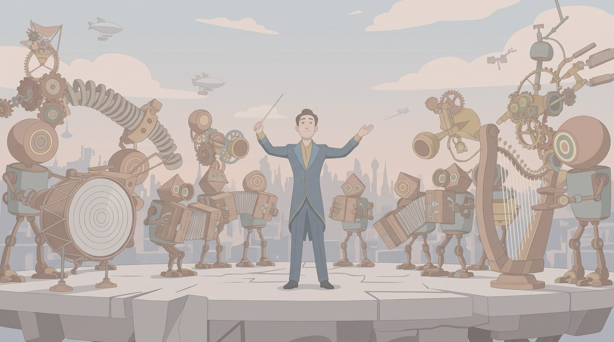

*Originally posted by [@daniel_mac8 on X](https://x.com/daniel_mac8/status/2123413769808138523). Reproduced here with credit.*

Thriving in the Intelligence Age requires a fundamental shift in how you view your own value. For the last few centuries, human prosperity was largely tied to cognitive scarcity: if you could memorize facts, synthesize information, write clearly, or analyze data faster than others, you held an advantage.

> When intelligence becomes abundant, cheap, and ambient—like electricity—**answers stop being scarce**. To thrive in that world, you must orient your life around the things that remain scarce, valuable, and irreducibly human.

**The six shifts at a glance:**

1. **Problem finding** over problem solving
2. **Taste and judgment** over raw production
3. **Accountability** — have skin in the game
4. **The physical and relational** over the synthetic
5. **Conductor**, not competitor
6. **Self-worth** decoupled from economic output

---

## 1. Shift from *Problem Solving* to *Problem Finding*

Artificial intelligence is extraordinary at optimization: give it a clear goal, and it will find a path. What it lacks is **genuine desire, lived friction, and the innate urge to care** about what happens next.

- **Cultivate high agency:** Stop waiting for instructions or credentials. The most valuable people will be those who look at the world, notice what is broken, missing, or needlessly painful, and take the initiative to fix it.
- **Ask better questions:** When execution becomes effortless, the quality of your life and work is determined by the quality of your intent. Learn to frame problems deeply before rushing to solve them.

## 2. Develop Taste, Judgment, and Discernment

When anyone can generate a thousand designs, strategies, or essays in seconds, the world doesn't suffer from a shortage of content—it drowns in average output. The bottleneck moves from **production to curation**.

- **Build deep taste:** Expose yourself to the best of human history—great literature, art, architecture, science, and craft. Understand *why* something works, not just *that* it works.
- **Guard your cognitive muscles:** It is tempting to outsource all thinking to machines. Resist that. If you never struggle through a hard problem, write a difficult paragraph from scratch, or sit with ambiguity, your judgment will atrophy. **Use AI to expand your reach, not to replace the friction that builds wisdom.**

## 3. Take Accountability (Have Skin in the Game)

An algorithm cannot feel shame, grieve a mistake, look a customer in the eye, or bear the moral weight of a decision.

> In a world of automated systems, **trust and accountability become the ultimate currency**.

- People will always value a human being who stands behind their work, makes hard ethical calls under uncertainty, and absorbs responsibility when things go wrong. Build a reputation as someone whose word carries weight.

## 4. Anchor Yourself in the Physical and Relational

As digital interactions become increasingly synthetic, frictionless, and infinite, the **real, physical, and local** will become profoundly more valuable—both economically and psychologically.

- **Invest in high-trust relationships:** Deep friendships, family, and local community are your greatest buffers against both economic volatility and the quiet alienation of a hyper-mediated world.
- **Stay embodied:** Move your body, cook real food, build things with your hands, spend time in nature, and sit in rooms with real people. Grounding yourself in physical reality keeps your nervous system sane and your perspective intact.

## 5. Become a Conductor, Not a Competitor

Do not try to out-compute a machine; you will lose, and you will make yourself miserable trying. Instead, **treat AI as a force multiplier for your curiosity and ambition**.

- **Think in systems:** Learn how to combine tools, people, and ideas to accomplish what used to require entire teams.
- **Stay radically adaptable:** **Hold your skills loosely and your curiosity tightly.** The half-life of specific technical workflows is shrinking; the ability to learn rapidly, unlearn old habits, and remain calm amid change is the meta-skill that compounds forever.

## 6. Decouple Your Self-Worth from Your Economic Output

This may be the deepest challenge of the coming era. Many people have built their entire identity around being "the smart one," "the fast writer," or "the expert." When a machine can match or surpass your professional craft, **an identity built solely on utility will fracture**.

- **Root your identity in character and meaning:** Your worth as a human being was never just your productivity. It lies in your capacity to love, to bear witness, to create meaning, to show courage, and to make the lives of the people around you warmer and more bearable.
- **Reclaim the joy of doing things for their own sake:** Play music even if a machine can compose faster. Write even if it can draft cleaner. Paint, garden, and learn simply because the *experience of doing it* is what makes a life worth living.

---

## Practical Daily Habits for the Intelligence Age

1. **Practice "Unassisted Thinking" Daily:** Spend at least 30 minutes a day reading deeply, journaling, or thinking through a problem with no screens or AI assistance. Keep your own voice sharp.
2. **Audit Your Inputs:** In an age of infinite synthetic noise, guard your attention fiercely. Choose slow, durable information (books, long-form essays, direct conversations) over algorithmic feeds.
3. **Build Something Real:** Every week, do at least one thing that exists in the physical world or directly helps another human being face-to-face.
4. **Experiment Fearlessly:** Dedicate time each week to playing with new tools without pressure. Curiosity cures anxiety; familiarity turns fear into leverage.

---

> In short: let the machines handle the abundance of calculation, so you can devote yourself to the scarcity of **wisdom, courage, taste, and love**. The Intelligence Age doesn't make humanity obsolete—it strips away the parts of our lives where we were acting like machines, and challenges us to finally become more fully human.
